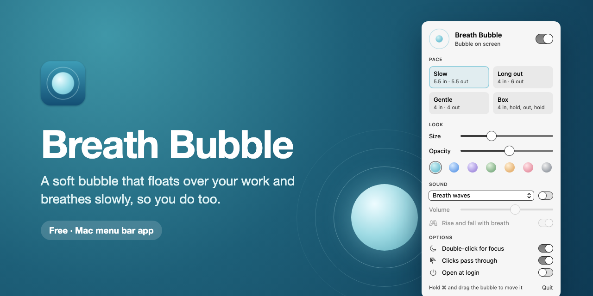
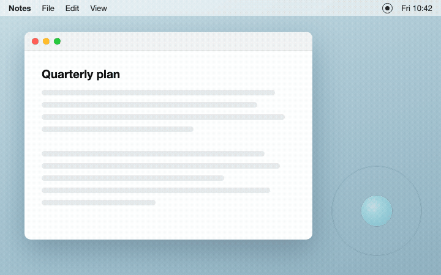
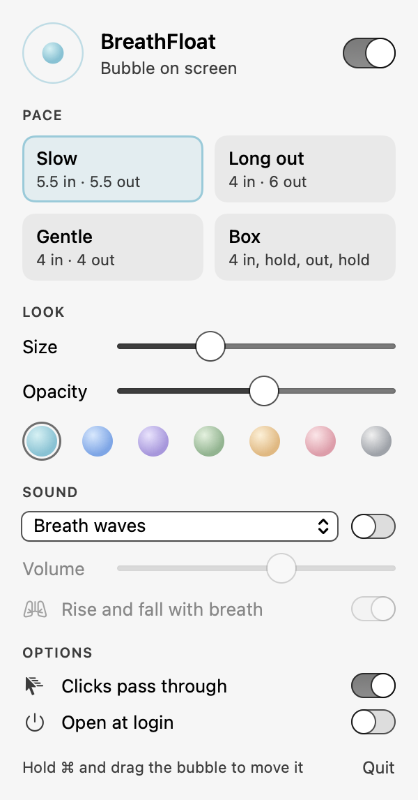

<p align="center">
  
</p>

<p align="center"><a href="https://github.com/simonwisdom/breath-bubble/releases/latest/download/BreathBubble.zip"><b>Download for macOS</b></a> · Free · macOS 13 or later</p>

<p align="center">
  <br>
  <sub><b>Breathe with it, without stopping.</b> The bubble grows as you breathe in and shrinks as you breathe out.</sub>
</p>

## Why I made it

A friend keeps his phone open beside his laptop with a bubble that grows and shrinks, and plays its sound in his earbuds. While working, he'd noticed he breathes fast and shallow, and following the bubble slows him down. I wanted the same thing on the Mac, floating over whatever I'm doing, with no phone needed.

## What it does

- A soft bubble that floats over every app and Space, full-screen ones included
- Four paces: Slow (5.5 in, 5.5 out), Long out (4 in, 6 out), Gentle (4 in, 4 out) and Box, or set your own breath-in and breath-out lengths
- Size, opacity and seven colours, set from the menu bar
- Optional sound that rises and falls with each breath: soft breath waves, or one of macOS's own Background Sounds (Ocean, Rain, Stream, Night, Fire and three noises), with its own volume
- Clicks pass straight through it; hold <kbd>⌘</kbd> and drag to move it
- Focus: double-click the bubble and the whole screen fills with black, leaving only the bubble, large, in the middle. Press any key or double-click to come back
- Choose how focus arrives: a plain Fade, a Tide that closes in from the edges, or Ink that spills out of the bubble; it fades in and out over a second each way
- Hidden from screen shares and recordings, and paused while your screen is locked

<p align="center">
  
</p>

## Install

1. Download `BreathBubble.zip` from the [latest release](https://github.com/simonwisdom/breath-bubble/releases/latest).
2. Unzip it and drag `Breath Bubble.app` into Applications.
3. Open it. The first time, macOS says it can't verify the app: open System Settings → Privacy & Security, scroll down and click **Open Anyway**.
4. Click the bubble icon in the menu bar to choose a pace, colour and sound. Turn on **Open at login** to have it every day.

Requires macOS 13 (Ventura) or later.

## Privacy

- No analytics, no network access, no account.
- Settings stay on your Mac.

## Build from source

Needs Xcode 15 or later (or the Swift toolchain).

```sh
tools/make-assets   # optional: app icon and README pictures (needs Google Chrome and ffmpeg)
bin/build           # makes build/Breath Bubble.app and build/BreathBubble.zip
```

`BreathBubble --snapshot <folder>` draws the settings panel to PNGs, and `BreathBubble --check-sounds` checks the sound files load, both without opening anything on screen.

## License

MIT. See `LICENSE`.
